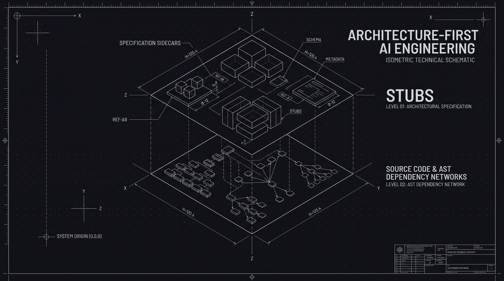
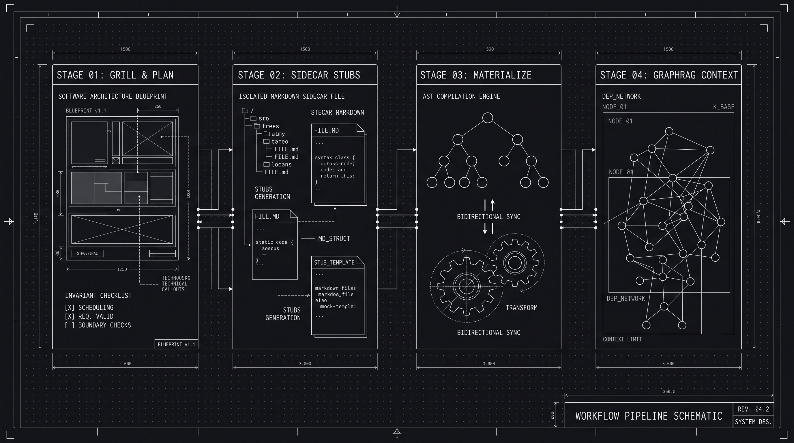

<p align="center">
  
</p>

<p align="center">
  <a href="#quick-start"></a>
  <a href="QUICKSTART.md"></a>
  <a href="#token-optimal-graphrag"></a>
  <a href="packages/tale"></a>
  <a href="LICENSE"></a>
</p>

---

## AI has changed the way we write code, but it shouldn't change the way we engineer it.

AI coding assistants write code at blistering speed—yet large codebases are breaking faster than ever. When agents make blind edits, they strip critical docstrings, hallucinate system invariants, trigger compile errors across unfinished files, and incinerate tens of thousands of tokens exploring directory trees they don't comprehend.

**`stubs` restores engineering discipline to AI-assisted development.**

Instead of jumping directly from an ambiguous prompt into messy source modifications, `stubs` gives human engineers and autonomous agents a rigorous, specification-first workflow: plan architectural concepts upfront, stress-test decisions with interactive grilling, isolate stubbed code safely inside Markdown sidecars, and explore dependencies through an ultra-lean, token-optimal AST GraphRAG engine.

```
┌────────────────────────────────────────────────────────────────────────────────────────┐
│                        UNCHECKED AGENTS vs. ARCHITECTURE-FIRST                         │
├──────────────────────────────────────────┬─────────────────────────────────────────────┤
│        Without stubs (Chaos)             │              With stubs (Order)             │
├──────────────────────────────────────────┼─────────────────────────────────────────────┤
│ ❌ Dumps 50,000+ raw tokens per query    │ ✅ Surgical GraphRAG queries (<350 tokens)  │
│ ❌ Strips comments & deletes docstrings  │ ✅ Sidecar markdown shields production code │
│ ❌ Half-written files break the build    │ ✅ Safe stubbing isolated until ready       │
│ ❌ Fluffy prompts cause erratic code     │ ✅ TALE engine cuts spec tokens by 50%      │
│ ❌ Hallucinated interfaces & drift       │ ✅ Automated grilling & AST reconciliation  │
└──────────────────────────────────────────┴─────────────────────────────────────────────┘
```

---

<p align="center">
  
</p>

---

## Quick Start: Zero to Configured in 60 Seconds

Install `stubs` into your project or launch the global interactive setup with a single terminal command:

```bash
npx @bicyclebutler/stubs
```

> **Note:** Once `@bicyclebutler/stubs` is installed locally in your project (`npm install -D @bicyclebutler/stubs`), you can invoke commands directly with `stubs <command>` or `npx stubs <command>`. Use `npx @bicyclebutler/stubs` for one-shot, bootstrap, or global runs.

The interactive terminal UI (`@clack/prompts`) will immediately guide you through configuring your workspace, selecting modular skills (`tale`, `design`, `stubs`), and binding local or Model Context Protocol (MCP) servers.

> **Need command flags, CI options, or step-by-step tutorials?**  
> Check out the complete **[Quickstart & Usage Guide](QUICKSTART.md)**.

---

## The Four Core Pillars

### 1. Plan Before Writing: Blueprints & The Grilling Engine

Great software engineering starts with architectural intent, not blind code generation. `stubs` introduces **Concept Blueprints** and the interactive **Grilling Engine** to eliminate design flaws before a single line of production code is written.

- **Stress-Test Invariants:** Run `stubs grill` to interview agents and engineers on edge cases, data lifecycles, and architectural decision records (ADRs).
- **Resolve Dependencies Early:** Walk down each branch of the design tree, forcing alignment on interfaces and boundaries.
- **Stop Hallucinations:** Ground agents in immutable requirements rather than open-ended natural language prompts.

```bash
# Stress-test a new authentication spec before writing code
stubs grill "OAuth2 Session Management with PKCE"
```

---

### 2. Markdown Sidecars: Safe Stubbing Without Broken Builds

AI agents frequently introduce syntax errors and destroy existing code when attempting contiguous file replacements. `stubs` solves this with **Sidecar Files** (`*.ts.md`, `*.py.md`, `*.go.md`).

- **Isolated Safe Stubbing:** Stub types, interfaces, and function signatures in co-located markdown sidecars. Code remains isolated until it is completely verified and materialized.
- **Zero Build Breakages:** Incomplete or experimental agent implementations never trigger compiler or linter errors in your primary source tree.
- **Protected Comments & Context:** Agents cannot accidentally wipe docstrings, comments, or surrounding implementations.
- **Automated AST Sanding (`stubs sand`):** Two-way synchronization reconciles physical code changes back into markdown specifications with zero drift.

#### Side-by-Side: Raw Edits vs. Sidecar Stubs

```diff
# Without stubs: Blind agent edit destroys comments and leaves broken exports
- /**
-  * Critical crypto hash invariant: Must use Argon2id with 64MB memory cost
-  */
  export async function hashPassword(pwd: string) {
-   return argon2.hash(pwd, { memoryCost: 65536 });
+   // Agent replaced with unfinished stub that breaks compilation
+   const hash = crypto.createHash('sha256'); ...
```

````markdown
<!-- With stubs: Clean, protected sidecar specification (src/auth.ts.md) -->

---

target: src/auth.ts
status: drafting
---

## Method: `hashPassword`

```typescript
export async function hashPassword(pwd: string): Promise<string> {
  // Safe stub: verified against ADR-004 before materializing to src/auth.ts
}
```
````

---

### 3. Token-Optimal Code Intelligence: 85%+ Context Savings

AI agents do not need your entire codebase dumped into their context window. In fact, large context stuffing degrades reasoning quality and skyrockets inference bills.

`stubs` embeds an in-memory AST dependency engine with Louvain community detection, PageRank centrality, and FTS5 BM25 hybrid search, accessible via **3-Tier Progressive Disclosure**:

| Tier                        | Command                                                                                                       | Token Cost      | What Agent Receives                                                                                      |
| :-------------------------- | :------------------------------------------------------------------------------------------------------------ | :-------------- | :------------------------------------------------------------------------------------------------------- |
| **Level 0: Macro Map**      | `stubs query "map:"`                                                                                          | **~340 tokens** | High-level subsystem communities, God Node coupling hubs, and monorepo boundaries.                       |
| **Level 1: Skeleton Stub**  | `stubs query "stub: src/auth.ts"`                                                                             | **~150 tokens** | Function/class signatures, docstrings, and line ranges (`auth.ts#L10-L45`) with bodies stripped (`...`). |
| **Level 2: Surgical Query** | `stubs query "explain: AuthService"`<br>`stubs query "path: api to db"`<br>`stubs query "blast: src/auth.ts"` | **<500 tokens** | Exact caller/callee trees, shortest dependency chains, or downstream impact radius.                      |

#### Universal Model Context Protocol (MCP)

`stubs` exposes an ultra-lean stdio MCP server (`stubs_query` and `stubs_scan`) with a schema overhead under **200 tokens**, keeping your agent prompt lean while empowering it with total codebase awareness:

```json
{
  "mcpServers": {
    "stubs": {
      "command": "npx",
      "args": ["stubs", "mcp"]
    }
  }
}
```

---

### 4. TALE: Halving Markdown Tokens with Simplified Technical English

AI agents become inconsistent, verbose, and erratic when prompted with conversational filler. `stubs` integrates **`tale`** (`@bicyclebutler/tale`), enforcing **ASD-STE100 Issue 9 Simplified Technical English (STE)** across specs, agent prompts, and documentation.

- **Cuts Markdown Tokens in Half:** Eliminates conversational pleasantries, ambiguous qualifiers, and passive voice overhead.
- **Unambiguous Directives:** One word, one meaning. Prevents agents from misinterpreting constraints or misapplying design tokens.
- **Automated STE Linter:** Instant feedback via `stubs lint:tale` or through agent hooks.

#### Comparison: Verbose Fluff vs. TALE Precision

```markdown
<!-- Before TALE: 84 tokens, ambiguous qualifiers, passive voice -->

It would be ideal if the developer or agent could make sure that the authentication token
is possibly verified before attempting to dispatch any asynchronous requests to the database,
in order to prevent potential unauthorized access exceptions.

<!-- After TALE: 22 tokens (74% savings!), crystal-clear imperative logic -->

Verify the authentication token before you send a database request.
Do not send unverified requests.
```

---

## Modular Package Ecosystem

The `stubs` project is organized as a high-performance npm monorepo with modular workspaces:

| Package    | Name                                            | Description                                                                   |
| :--------- | :---------------------------------------------- | :---------------------------------------------------------------------------- |
| **CLI**    | [`@bicyclebutler/stubs`](packages/cli)          | Interactive Clack TUI orchestrator, project initializer, and workflow runner. |
| **Core**   | [`@bicyclebutler/stubs-core`](packages/core)   | Zero-LLM local AST engine, SQLite dependency graph, and sidecar materializer. |
| **TALE**   | [`@bicyclebutler/tale`](packages/tale)         | ASD-STE100 Issue 9 Simplified Technical English linter and skill suite.       |
| **Design** | [`@bicyclebutler/design`](packages/design)     | UI/UX design tokens, accessibility rules, ADR compliance, and audits.         |

---

## Sub-Skills Reference

When paired with modern agent environments (such as Antigravity, Claude Code, or Cursor), `stubs` provides granular sub-skills located under `.agents/skills/stubs/sub-skills/`:

| Sub-Skill                                                                       | Purpose                                                                                    |
| :------------------------------------------------------------------------------ | :----------------------------------------------------------------------------------------- |
| **[conceptualizing](.agents/skills/stubs/sub-skills/conceptualizing/SKILL.md)** | Problem framing, requirements gathering, and blueprint generation.                         |
| **[grilling](.agents/skills/stubs/sub-skills/grilling/SKILL.md)**               | Interactive and automated spec stress-testing and architectural inquiry.                   |
| **[materialization](.agents/skills/stubs/sub-skills/materialization/SKILL.md)** | Sidecar code extraction, in-memory TypeScript typechecking, and code generation.           |
| **[sanding](.agents/skills/stubs/sub-skills/sanding/SKILL.md)**                 | AST structural hashing, frontmatter auto-healing, and bi-directional drift reconciliation. |
| **[context](.agents/skills/stubs/sub-skills/context/SKILL.md)**                 | Token-optimized tiered context slices and LLM briefing generation.                         |
| **[context-mapping](.agents/skills/stubs/sub-skills/context-mapping/SKILL.md)** | Hierarchical context maps (`context-map.md`) & domain index management.                    |
| **[auditing](.agents/skills/stubs/sub-skills/auditing/SKILL.md)**               | Workspace health checks, cycle detection, and God-node hotspot analysis.                   |
| **[diagram](.agents/skills/stubs/sub-skills/diagram/SKILL.md)**                 | Mermaid diagram generation for dependency flows and sequence interactions.                 |
| **[lint](.agents/skills/stubs/sub-skills/lint/SKILL.md)**                       | Architecture invariant verification, layer hierarchy checking, and drift linting.          |
| **[mock](.agents/skills/stubs/sub-skills/mock/SKILL.md)**                       | Spec-driven test suite generation and typed mock harness generation.                       |
| **[changelog](.agents/skills/stubs/sub-skills/changelog/SKILL.md)**             | Semantic architectural changelog generation and spec diff tracking.                        |
| **[pruning](.agents/skills/stubs/sub-skills/pruning/SKILL.md)**                 | Detection and cleanup of orphaned specs, untracked source files, and zombie exports.       |

---

## 📐 Core Engineering Principles

1. **Deep Modules:** Simple public interfaces that conceal rich internal logic.
2. **Context Objects:** Group session, environment, and user state into unified parameters (`AuthContext`, `CliContext`) to prevent parameter explosion.
3. **Define Errors Out of Existence:** Prefer explicit `Result<T, E>` returns and idempotent APIs over disruptive runtime exceptions.
4. **Self-Healing Frontmatter:** Collisions or missing YAML fields never crash the parser; auto-reconciles on write.
5. **Zero-Model Local Core:** Deterministic parsing, graph indexing, AST hashing, and typechecking execute locally with zero API keys and 0 token overhead.

---

<p align="center">
  Ready to elevate your agentic engineering workflow?<br />
  <strong><a href="QUICKSTART.md">Read the Quickstart & Usage Guide →</a></strong>
</p>
